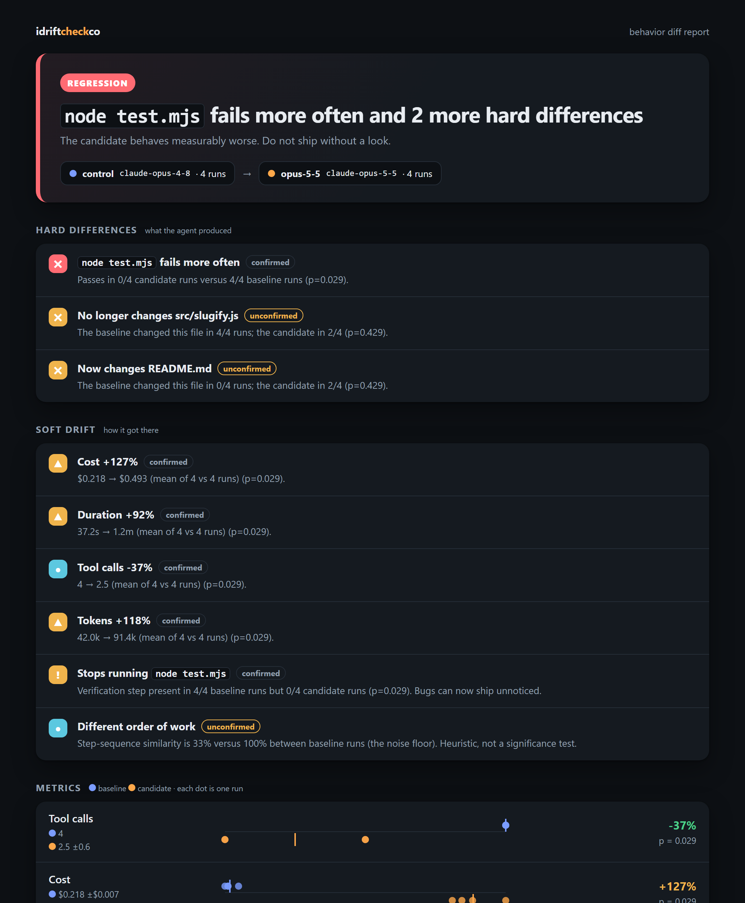

<div align="center">

# idriftcheckco

**Upgrade your model or prompt without silently breaking your agent.**

Replays the agent sessions you already have under a changed condition, then diffs the
behavior: files touched, checks passed, tool sequence, steps, cost. With variance, not vibes.

[](https://github.com/MicoleKurt/idriftcheckco/actions/workflows/ci.yml)
[](https://www.npmjs.com/package/idriftcheckco)
[](LICENSE)




**[See a live example report →](https://micolekurt.github.io/idriftcheckco/demo/)**

</div>

## Try it in three commands

```bash
npx idriftcheckco demo        # 10 seconds, offline, free: see a real report
npx idriftcheckco             # finds YOUR sessions, ranks them for replay
npx idriftcheckco replay <session> --model <new-model> --dry-run   # cost first
```

No dataset to write, no config file, no account. It reads sessions you already have.
Before any paid run, `idriftcheckco doctor` (and every `replay`, automatically) checks
that the agent CLI is installed and logged in, so nothing is spent on runs that would fail.

The terminal above is the real output of `demo`: a scripted agent replayed through the
genuine worktree, git-diff and statistics pipeline. The same run produces this report:

<p align="center"><a href="https://micolekurt.github.io/idriftcheckco/demo/"></a></p>

## Why

Model and prompt upgrades fail quietly. The new model still "finishes" and still sounds
confident, but it stopped running the tests, edited a different file, or doubled your
bill. Eval platforms catch this only if you first write a dataset. You already have a
dataset: every session your agent ever ran.

| | idriftcheckco | Eval platforms (LangSmith, Braintrust, Langfuse, ...) | Prompt test runners (promptfoo, ...) |
|---|---|---|---|
| Needs a dataset you write | **No**, uses your past sessions | Yes | Yes |
| Understands whole agent runs (files, tools, commands) | **Yes** | Via instrumentation | Mostly single prompts |
| Runs locally, no account, no telemetry | **Yes** | Hosted or self-hosted service | Yes |
| Statistics for run-to-run noise | **Yes** (exact tests, honest about small N) | Varies | Varies |
| Ground truth from a real git diff | **Yes** | No | No |

These tools are good and complementary; idriftcheckco is deliberately narrow. See
[docs/competitors.md](docs/competitors.md) for an honest gap analysis, including what
we do **not** do.

## How it works

```text
 your past sessions ──import──▶ redacted JSON traces (.idriftcheckco/, git-friendly)
                                        │
        replay: for each arm × N runs   ▼
   ┌─────────── control (unchanged) ─┐   fresh isolated git worktree per run
   │ ┌───────── candidate (new model)┤   agent re-attempts the task
   │ │                               │   ground truth: git diff + your check command
   └─┴──────────▶ diff ──▶ terminal · HTML · JSON · PR comment · exit code
```

1. **Import.** Sessions are parsed by a thin adapter, redacted (keys, tokens, home paths)
   and stored as plain JSON.
2. **Replay.** The task is re-run in a throwaway `git worktree` (your checkout is never
   touched). By default the *unchanged* setup is re-run too, as a **control**, so
   "model changed" is not confused with "replay differs from real life".
3. **Diff.** Findings are split into **hard** (different files, failing check, agent
   stops finishing) and **soft** (cost, steps, tokens, time, tool order, a dropped test
   run). Reads and searches are ignored when comparing order: reordering is noise.
4. **Verdict.** Each finding is `confirmed` (statistically supported) or `unconfirmed`
   (large effect, too few runs to prove). The report says how many runs you need.

### Reading a verdict

| Verdict | Meaning | CI default |
|---|---|---|
| `regression` | A hard difference that is statistically supported | fail |
| `likely-regression` | A large hard difference, but too few runs to confirm | fail |
| `drift` | Soft differences (cost, steps, ...) that are supported | pass (`--fail-on drift` to fail) |
| `possible-drift` | Soft differences that may be noise | pass |
| `no-change` | Nothing beyond normal variation | pass |

**Pay for fewer runs: `--runs auto`.** Instead of a fixed count, the replay looks at the
data at planned points (5, 7 and 8 runs per side by default) and stops as soon as the
answer is clear: a confirmed regression, or no sign of any difference. The significance
level is split across the looks (Bonferroni), so stopping early never adds false
positives. An obvious regression costs 10 runs instead of 16.

Statistics are exact permutation tests (numeric) and Fisher's exact test (proportions):
no distribution assumptions, valid at the 3 to 10 runs you can afford. The honest
consequence: with 3 runs per side the smallest possible p-value is 0.10, so nothing can
be `confirmed` below 4 runs per side. The tool tells you this instead of guessing.

## Use it on your own sessions

```bash
npx idriftcheckco                       # 1. find and rank your sessions
npx idriftcheckco import a1b2c3d4       # 2. save one as a redacted trace
npx idriftcheckco replay a1b2c3d4 \     # 3. test a change
    --model <new-model> --runs 4 --check "pnpm test" --dry-run
```

Drop `--dry-run` to run it. You will see the estimated cost, and in a terminal you will be
asked to confirm; in CI you must pass `--yes`. What you can change:

| Flag | Tests |
|---|---|
| `--model <id>` | A new model |
| `--prompt-file <f>` | Edited instructions |
| `--overlay CLAUDE.md=./CLAUDE.new.md` | An edited project instructions file (or any file) |
| `--mcp-config <f>` | A different MCP server set |

Everything else: `idriftcheckco <command> --help`. Commands: `scan` (default), `import`,
`replay`, `diff`, `report`, `ci`, `record`, `demo`, `doctor`.

## Use it in CI

```yaml
# .github/workflows/agent-drift.yml
on: pull_request
permissions: { contents: read, pull-requests: write }
jobs:
  drift:
    runs-on: ubuntu-latest
    steps:
      - uses: actions/checkout@v4
      - uses: MicoleKurt/idriftcheckco/action@v0
        env:
          ANTHROPIC_API_KEY: ${{ secrets.ANTHROPIC_API_KEY }}
        with:
          model: claude-opus-5-5
          runs: auto            # stops early when the answer is clear
          check: pnpm test
          max-cost: 10          # hard spending cap for the whole job
```

Pin `version: 0.1.0` to run the published package; leave it empty to build from the
action's own source. It is tested end to end on every push by
[a self-test workflow](.github/workflows/action-selftest.yml) that must catch the demo regression.

The Action replays your committed traces (`.idriftcheckco/traces/`), comments on the PR
(updating its own comment), uploads the HTML report as an artifact, and fails the job on
regression. Exit codes everywhere: `0` ok · `1` regression found · `2` bad invocation ·
`3` runtime failure.

**README badge.** `ci --badge-out badge.json` writes a
[shields.io endpoint](https://shields.io/badges/endpoint-badge) payload you can publish
to a gist or Pages and embed as `https://img.shields.io/endpoint?url=<raw-url>`.

## Configuration (optional)

Zero config works. Overrides live in `idriftcheckco.config.ts` (or `.mjs` / `.json`):

```ts
import { defineConfig } from 'idriftcheckco';

export default defineConfig({
  check: 'pnpm test',      // run after each attempt; exit 0 = pass
  runs: 4,                 // per side
  maxCostUsd: 10,          // hard cap per invocation
  env: ['NPM_TOKEN'],      // extra env var NAMES passed to the agent (others are withheld)
  prices: { 'my-model': { input: 1, output: 5, cacheRead: 0.1, cacheWrite: 1.25 } },
});
```

## Privacy and safety

- **Local-first.** No telemetry, no analytics, no update checks. The only network
  traffic is your own agent CLI calling the model provider you configured.
- **Redaction at ingest.** API keys, tokens, JWTs, `*_KEY=...` assignments, URL
  credentials and home-directory paths are removed before anything is written to disk.
  It is pattern-based, so skim a report before sharing it publicly.
- **Your repo is never touched.** Replays run in detached git worktrees under your OS
  temp directory and are removed afterwards, even on failure. Uncommitted changes are
  *not* carried into the replay.
- **Secrets stay out of the agent.** The agent process gets an allow-listed environment
  (PATH, auth for the model provider, ...). Your cloud and CI secrets are withheld unless
  you list them under `env`.
- **Money.** Replays are paid API calls. Cost is estimated first, confirmation is
  required, and `--max-cost` stops launching runs once the cap is hit.
- The HTML report is one file with no scripts and no network requests.

## How realistic is a replay?

A replay is only useful if it reproduces the conditions the agent originally worked in.
Each replay plan states, before anything runs, exactly what it reproduces:

```text
 Replay plan
   code:  Replaying on 3f2a91c (last commit on feature/login before the session started).
   tools: Bash, Edit, Read (as used in the original session)
   turns: first of 3 (add --turns all to replay the follow-ups)
```

| Condition | What idriftcheckco does |
|---|---|
| **The code as it was** | `--ref auto` (default) replays on the last commit on the session's branch before it started, not on today's `HEAD`. Override with `--ref <commit>`. |
| **The agent's permissions** | The replay may use the same tools the original session used (`allowedTools: "session"`), so it can run the tests the session ran instead of being blocked. Every arm gets the same set. |
| **The whole conversation** | `--turns all` replays every human follow-up, in order, in one resumed agent session, and cleans up the transcript it creates. Default is the first prompt only, because follow-ups were written in reply to the *old* model. |
| **Run-to-run noise** | Not removable, so it is measured: N runs per side, exact tests, `confirmed`/`unconfirmed`. |

## Limitations (please read)

- **External state is not reproduced.** Network calls, databases and MCP side effects
  may behave differently on replay. `scan` ranks sessions that lean on them lower.
- **Uncommitted work is not recovered.** `--ref auto` finds the last *commit*; edits that
  were never committed at session time are not in the replay.
- **Follow-ups are replayed verbatim.** With `--turns all`, later prompts were written for
  the old model's replies and may not fit the new model's. Use it to compare whole
  workflows, and read the per-turn notes.
- **Agents are non-deterministic.** One run proves nothing; use 4+ runs per side.
- **The session format is undocumented and changes.** Parsing is isolated in one adapter
  ([docs/session-format.md](docs/session-format.md)); it skips what it does not
  understand and says so. Currently supported source: Claude Code transcripts.
- **Cost figures are estimates** from a price table that you can override; after a run,
  the agent's own reported cost is used.
- **The live agent path is the least-tested part.** The runner is tested against a
  stand-in agent process (task via stdin, multi-turn resume, stream parsing, auth
  failure, timeouts, process-tree cleanup), but not yet in CI against a real paid run,
  and the agent CLI's output can change between versions. `idriftcheckco doctor` checks
  the install and login for free; before trusting results, do one tiny paid run:
  `idriftcheckco record "Reply ok" --yes --max-cost 0.05`.

## Development

```bash
pnpm install
pnpm check        # typecheck + lint + tests (no API key needed)
pnpm dev demo     # run the CLI from source
```

See [CONTRIBUTING.md](CONTRIBUTING.md) and the [roadmap](docs/ROADMAP.md), which lists
ten well-scoped good first issues. Design tradeoffs are in
[docs/DECISIONS.md](docs/DECISIONS.md).

## License

[MIT](LICENSE)
